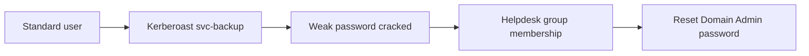

# Internal AD Lab Assessment

## Summary
I assessed a self-built Active Directory lab to find the shortest path from a standard user to domain admin. Two findings were critical to that path: a Kerberoastable service account with a weak password, and a helpdesk group that could reset Domain Admin passwords. Both are fixed in the retest.

## Scope and environment
- **In scope:** the lab domain `lab.example.local` (placeholder), its three workstations, and its file server.
- **Out of scope:** the lab host network and any real systems.
- **Environment:** VMs on an isolated host-only network (192.0.2.0/24). No real data.
- **Starting point:** a standard domain user, with credentials provided for the exercise.

## Methodology
1. **Reconnaissance:** host discovery and service enumeration with Nmap.
2. **Enumeration:** collected domain data with BloodHound and mapped group memberships and delegations.
3. **Exploitation:** requested service tickets for accounts with SPNs and cracked the offline hash in a lab environment.
4. **Privilege escalation:** used the helpdesk group's delegated password reset rights to reach Domain Admin.
5. **Retrospective:** documented remediation, then retested both findings.

The attack path is shown below.

## Findings

| ID | Title | Severity | Affected component | Remediation | Retest |
|---|---|---|---|---|---|
| F-01 | Kerberoastable service account with weak password | High | svc-backup (SPN set) | Use a managed service account or a 25+ character random password | Passed |
| F-02 | Helpdesk group can reset Domain Admin passwords | Critical | Delegated rights on the Domain Users OU | Remove delegation; enforce a tiered admin model | Passed |
| F-03 | SMB signing not required on file server | Medium | fs01 | Require SMB signing via Group Policy | Passed |

## Retrospective
- The fastest path came from a delegation I would have checked first next time. Running BloodHound's path queries early saved time.
- Next engagement I'd add a password policy audit before cracking, so the findings report includes the policy as well as the password.

## Files
- [Full report (PDF)](report.pdf)
